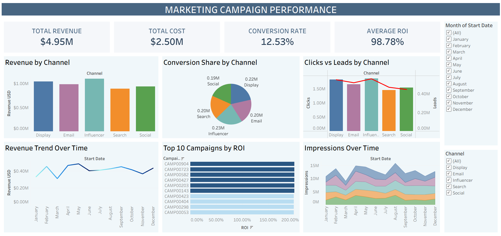

# Marketing Campaign Performance Analysis | Tableau

## Project Overview

This project analyzes marketing campaign performance across five channels: Display, Email, Influencer, Search, and Social.

The objective is to evaluate campaign effectiveness, compare channel performance, analyze marketing costs, and identify key insights using Tableau.

## Dashboard Preview

## Key Performance Indicators

- Total Revenue
- Total Cost
- Conversion Rate
- Average ROI

## Dashboard Visualizations

1. Revenue by Channel
2. Conversion Share by Channel
3. Clicks vs Leads by Channel
4. Revenue Trend Over Time
5. Impressions Over Time
6. Top 10 Campaigns by ROI

## Key Findings

- Influencer marketing generated the highest revenue.
- Influencer and Display contributed significantly to conversions.
- Revenue remained relatively stable throughout the year.
- Marketing costs varied across channels.
- Campaign performance differed across channels.

## Tools Used

- Tableau Public
- Microsoft Excel

## Dataset

The project uses a simulated marketing campaign
performance dataset containing 10,000 records
and 11 columns.

The dataset includes campaign details, marketing
channels, impressions, clicks, leads, conversions,
cost, revenue, and ROI.

## Project Files

- Dashboard screenshot (.png)
- Tableau packaged workbook (.twbx)
- Project presentation (.pdf)

## Author

Asmi Nazar T

Aspiring Data Analyst

LinkedIn: [Connect with me](https://www.linkedin.com/in/asmi-nazar-t-92b406443/)

